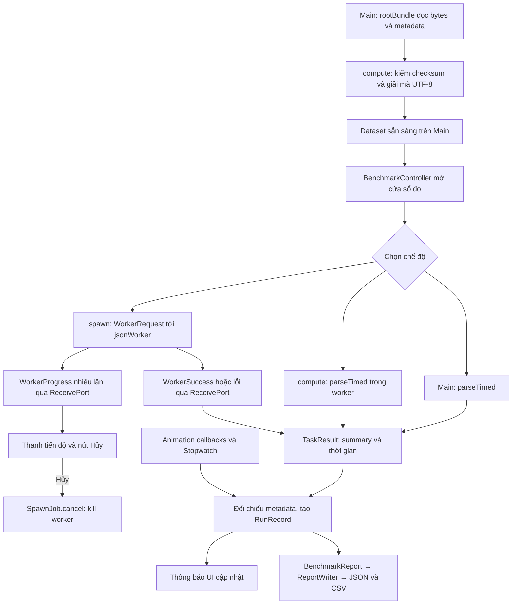

# Kiến trúc và luồng dữ liệu

App đọc một file JSON lớn, đếm số bản ghi và cộng `amount`. Ba chế độ chạy cùng một hàm xử lý. Khi chạy trên Main, tác vụ CPU có thể chặn giao diện; khi chạy trong worker, Main có thể tiếp tục vẽ vòng quay và nhận thao tác.

## Nhiệm vụ

| Thư mục | Nhiệm vụ |
|---|---|
| `lib/screens/` | Ghép màn hình, quản lý animation và sao chép clipboard |
| `lib/widgets/` | Các panel dữ liệu, tương tác, nút chạy, tiến độ/Hủy và kết quả |
| `lib/controllers/` | Trạng thái, khóa nút chạy, cửa sổ đo theo chế độ được chọn, tiến độ worker và lifecycle |
| `lib/models/` | Kiểu dữ liệu: summary, kết quả chạy, metadata, báo cáo và message worker |
| `lib/services/` | Nạp dataset, parse JSON, chạy Isolate, tính metrics và ghi file |

`BenchmarkController` dùng `ChangeNotifier`. Khi trạng thái hoặc kết quả thay đổi, controller gọi `notifyListeners()`; `ListenableBuilder` dựng lại giao diện. Controller không giữ widget, `BuildContext` hoặc animation. Callback animation chỉ gửi mốc thời gian vào controller, không yêu cầu dựng lại cả màn hình mỗi frame.

## Kiểu dữ liệu

- `ParseSummary`: `count`, `totalAmount`. Cả ba chế độ phải trả kết quả bằng nhau.
- `ParseResult`: summary và thời gian bên trong parser. `TaskResult` thêm thời gian toàn lời gọi.
- `RunRecord`: một lần đo, gồm chế độ, thời gian, metrics, lifecycle và lỗi nếu có.
- `WorkerRequest`: chuỗi JSON và `SendPort` trả lời.
- `WorkerMessage`: sealed class với `WorkerProgress`, `WorkerSuccess`, `WorkerDataError`, `WorkerFailure`.

Map được dùng ở ranh giới JSON: `jsonDecode`, kiểm tra trường đầu vào và `toJson`. Các lớp xử lý, controller và UI đọc thuộc tính có kiểu, không tra key chuỗi. Không tạo thêm 180.000 object nghiệp vụ vì app chỉ cần đếm và cộng tổng.

## SpawnJob.run hoạt động thế nào?

1. Tạo `ReceivePort` và đăng ký listener trước khi spawn. `Completer<ParseResult>` cung cấp Future để Main chờ kết quả.
2. Tạo timeout 60 giây, gọi `Isolate.spawn` với `WorkerRequest`. Chỉ gửi dữ liệu, không gửi controller hay UI.
3. Worker gọi parser. Trong bước kiểm tra bản ghi, worker gửi `WorkerProgress(done, total)` khoảng 10 lần. `jsonDecode` là một lời gọi nguyên khối nên phần giải mã không có tiến độ; message tiến độ đầu tiên đến sau khi giải mã xong.
4. Thành công gửi `WorkerSuccess`; JSON sai gửi `WorkerDataError`; lỗi khác gửi `WorkerFailure` kèm tên kiểu và stack trace.
5. Main xử lý message bằng `switch`. `WorkerProgress` gọi `onProgress` và không kết thúc job. Chỉ `WorkerDataError` trở thành `FormatException`; lỗi xử lý khác thành `RemoteWorkerException`.
6. `onError` nhận lỗi chưa được worker bắt; VM gửi chuỗi lỗi và stack, nên tên loại được ghi là `uncaught`. `onExit` trả null nếu worker kết thúc mà chưa có kết quả.
7. Future hoàn tất hoặc lỗi đều đi qua `finally`: hủy timer, subscription, đóng port và kill worker. Nếu đóng màn hình trước khi spawn hoàn tất, worker vừa tạo cũng được kill.

Các thông báo dùng chung một port nên tiến độ luôn đến trước kết quả, kết quả đến trước thông báo thoát. Mỗi `SpawnJob` chỉ chạy một lần.

## Tiến độ và Hủy

Khi chạy `Isolate.spawn`, controller tạo `SpawnJob(onProgress: ...)` và lưu `progress` (0..1). `RunControlsPanel` hiện thanh tiến độ và nút **Hủy worker**. Nút này gọi `controller.cancelRun()` → `SpawnJob.cancel()`: Future kết thúc bằng `WorkerCancelled`, worker bị kill ngay, trạng thái chuyển thành "Đã hủy" và mẫu đo đang chạy được ghi `incomplete`.

Panel chạy có ba nút Main/compute/spawn và một nút thử JSON lỗi. `execute(mode)` chỉ đo chế độ được chọn; `tryInvalidJson()` đi qua worker để minh họa bắt lỗi và phục hồi. Không còn luồng warm-up, batch hoặc đo không tải. Cửa sổ đo 5 giây vẫn giữ để tính FPS/gap, không phải vòng chạy lặp.

Đây là điểm `Isolate.spawn` làm được mà `compute` không làm được: nhận nhiều message trong lúc chạy và dừng worker giữa chừng. `compute` không có thao tác kill trực tiếp trong app; controller bỏ kết quả đến sau dispose.

Mỗi message tiến độ làm UI dựng lại một lần, tức khoảng 10 lần cho mỗi lần chạy spawn. Chi phí này nhỏ so với cửa sổ đo 5 giây nhưng là khác biệt giữa chế độ spawn và compute; cần nêu khi so sánh số liệu.

## Chuẩn bị dữ liệu và đo

`rootBundle` đọc asset trên Main. `prepareDataset` chạy trong `compute` để tính checksum và giải mã 28 MB UTF-8. Việc này hoàn tất trước khi cho chạy benchmark. Đọc asset, chuyển dữ liệu giữa isolate và cấp phát vẫn có chi phí; không coi đó là thời gian parse được đo.

`FrameMetrics` ghi thời điểm callback bằng cùng một Stopwatch. `estimatedUiFps = số callback / số giây thực tế`. Ví dụ cửa sổ 5 giây nhận 250 callback thì kết quả là 50 callback/giây, kể cả một đoạn UI đứng trong 5 giây đó.

`maxGapMs` lấy khoảng cách lớn nhất từ đầu cửa sổ đến callback đầu, giữa hai callback liên tiếp, và từ callback cuối đến cuối cửa sổ. Nếu không có callback, gap bằng cả cửa sổ. Đây là cách thấy một lần khựng dài mà FPS trung bình có thể che khuất.

Chi tiết phép đo: [BENCHMARK.md](BENCHMARK.md). UI FPS là nhịp callback, chưa được đối chiếu với DevTools/FrameTiming.

Nguồn: [compute](https://api.flutter.dev/flutter/foundation/compute.html), [gửi message giữa isolate](https://api.dart.dev/dart-isolate/SendPort/send.html).
